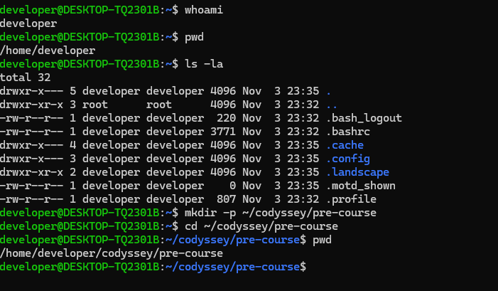
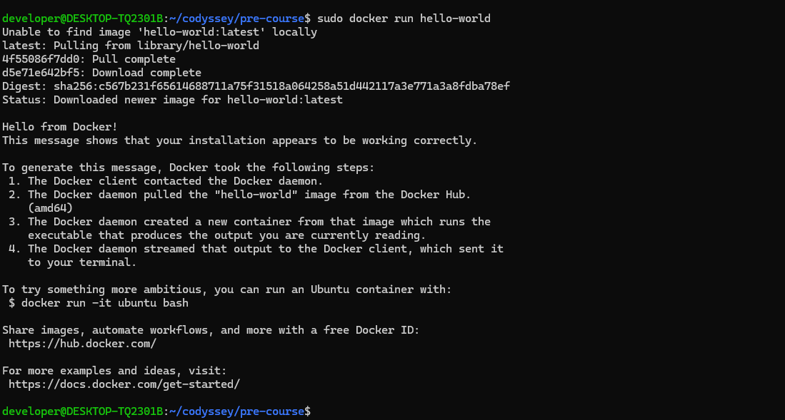
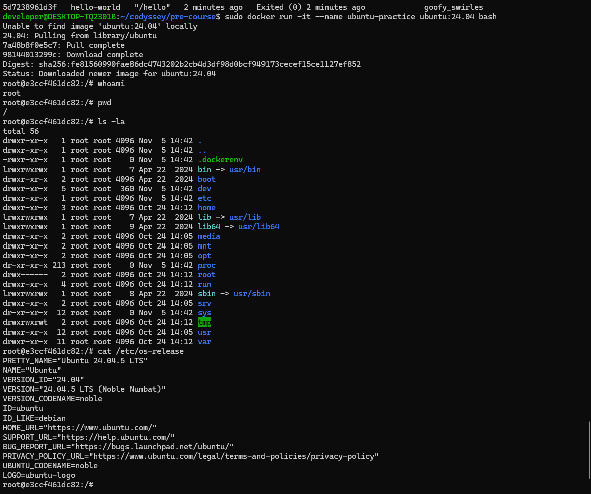
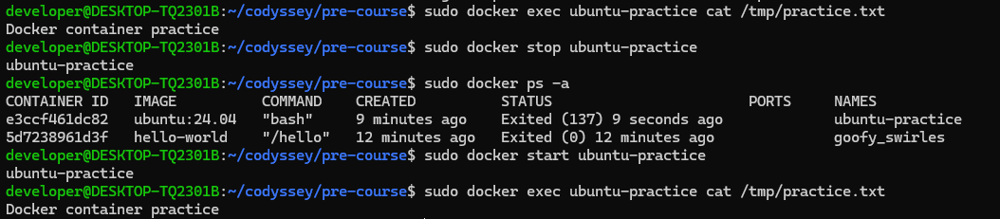
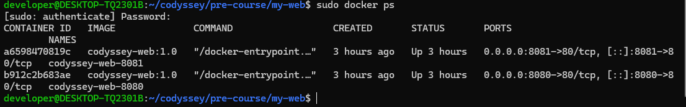
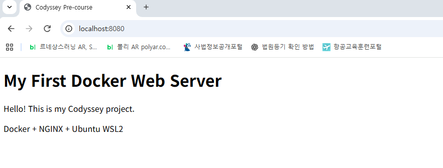
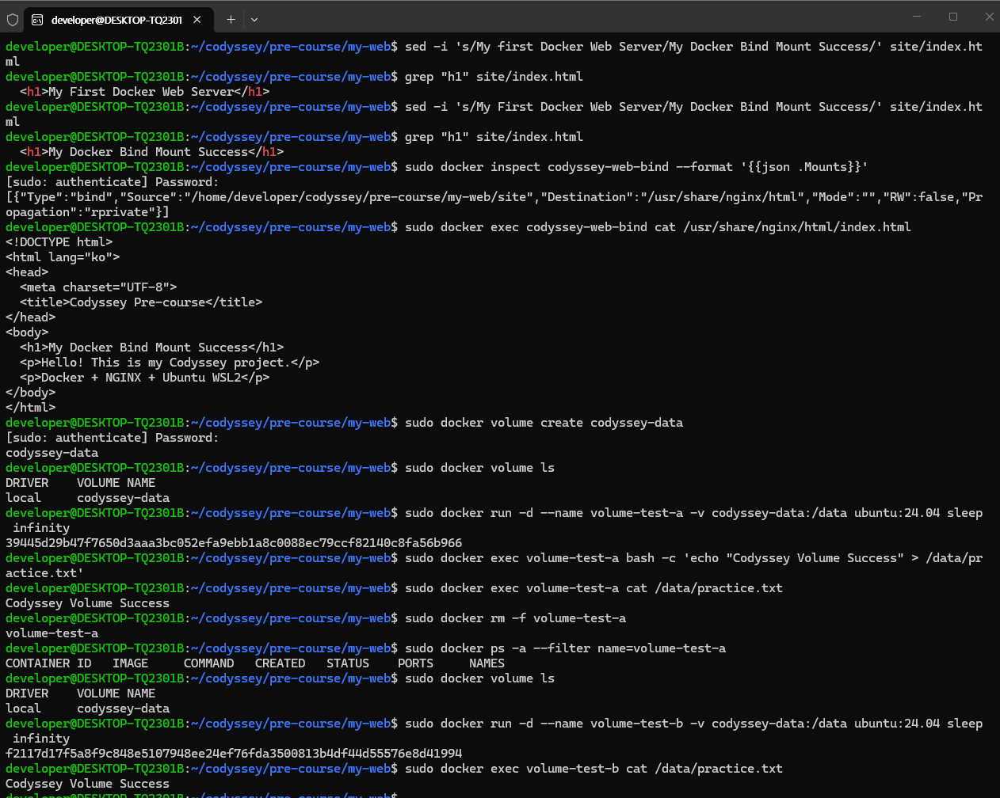

# Codyssey Pre-course

Codyssey 입학연수에서 Ubuntu/WSL2, Linux, Docker, Git, GitHub의 기본 사용법을 직접 실습하고 결과를 기록한 저장소입니다. 이 문서는 저장소의 파일, 업로드된 스크린샷, 완료된 Pull Request를 기준으로 재현 절차와 확인 결과를 정리합니다.

> 검증 표기
>
> - **검증 완료**: 저장소 스크린샷, 파일 또는 GitHub 기록에서 결과를 확인함
> - **기록 기반**: 기존 실습 기록에는 있으나 버전 출력 등 직접 증거가 부족함
> - **추가 검증 필요**: 실행 결과나 스크린샷이 아직 저장소에 없음

## 1. 수행 결과 요약

| 영역 | 수행 내용 | 상태 | 근거 |
| --- | --- | --- | --- |
| Ubuntu/WSL2 | Ubuntu 설치 및 WSL 2 실행 | 검증 완료 | [Ubuntu 설치](screenshots/01-ubuntu-install.png), [WSL 상태](screenshots/02-wsl-version.png) |
| Linux | 사용자·현재 경로·파일 목록 확인, 작업 폴더 생성 | 검증 완료 | [Linux 명령 실행](screenshots/03-linux-commands.png) |
| 권한 | 파일·디렉터리 권한 실습 | 기록 기반 | `permissions/test.txt` 존재, 변경 전후 출력은 추가 검증 필요 |
| Docker 설치 | `hello-world` 실행 | 검증 완료 | [Hello World](screenshots/docker-hello-world.png) |
| 컨테이너 | Ubuntu 24.04 실행, 중지·재시작 | 검증 완료 | [Ubuntu 컨테이너](screenshots/docker-ubuntu.png), [중지·재시작](screenshots/docker-stop-start.png) |
| 커스텀 이미지 | Dockerfile로 NGINX 이미지 빌드 | 검증 완료 | `my-web/Dockerfile`, 실행 컨테이너 화면 |
| 포트 매핑 | 호스트 8080·8081 포트로 컨테이너 80 포트 연결 | 검증 완료 | [두 포트 실행](screenshots/docker-two-ports.png) |
| 웹 접속 | `http://localhost:8080` 접속 | 검증 완료 | [브라우저 접속](screenshots/docker-web-browser.png) |
| 바인드 마운트 | 호스트 HTML 변경이 컨테이너에 반영됨 | 검증 완료 | [마운트·컨테이너 내부 확인](screenshots/docker-volume-persistence.png) |
| Docker 볼륨 | 컨테이너 삭제 뒤에도 데이터 유지 | 검증 완료 | [볼륨 영속성 확인](screenshots/docker-volume-persistence.png) |
| Git/GitHub | 저장소, 브랜치, Push, PR 병합 | 검증 완료 | [Pull Request #1](https://github.com/sukwonji77-svg/codyssey-pre-course/pull/1) |
| VS Code 연동 | VS Code에서 GitHub 저장소 연동 | 추가 검증 필요 | 관련 화면 또는 실행 기록 없음 |
| Docker 운영 정보 | `docker logs`, `docker stats`, `docker info` | 추가 검증 필요 | 관련 출력 기록 없음 |

## 2. 실습 환경

| 항목 | 환경/버전 | 검증 상태 |
| --- | --- | --- |
| Host OS | Windows | 기록 기반 — 정확한 Windows 버전은 추가 검증 필요 |
| Linux 실행 환경 | WSL 2 | 검증 완료 (`wsl -l -v`에서 Ubuntu의 VERSION이 `2`) |
| WSL Ubuntu 배포판 | Ubuntu 26.04 LTS | 기록 기반 — 기존 README의 기록이며 `lsb_release -a` 출력은 없음 |
| Docker 실습 이미지 | `ubuntu:24.04`, `nginx:alpine`, `hello-world:latest` | 검증 완료 |
| Ubuntu 컨테이너 | Ubuntu 24.04.5 LTS (Noble Numbat) | 검증 완료 (`/etc/os-release`) |
| Docker Engine | 설치 및 정상 실행 | 검증 완료 — 정확한 버전은 추가 검증 필요 |
| Git | 2.53.0 | 기록 기반 — `git --version` 출력은 추가 검증 필요 |
| GitHub 저장소 | `sukwonji77-svg/codyssey-pre-course` | 검증 완료 |

환경 정보를 다시 확인하려면 다음 명령을 실행합니다.

```powershell
wsl -l -v
```

```bash
cat /etc/os-release
docker --version
docker info
git --version
```

## 3. 저장소 구조

```text
codyssey-pre-course/
├── .gitignore
├── README.md
├── my-web/
│   ├── Dockerfile
│   └── site/
│       └── index.html
├── permissions/
│   └── test.txt
├── screenshots/
│   ├── 01-ubuntu-install.png
│   ├── 02-wsl-version.png
│   ├── 03-linux-commands.png
│   ├── docker-hello-world.png
│   ├── docker-stop-start.png
│   ├── docker-two-ports.png
│   ├── docker-ubuntu.png
│   ├── docker-volume-persistence.png
│   └── docker-web-browser.png
└── test.txt
```

## 4. 재현 절차

### 4.1 저장소 받기

```bash
git clone https://github.com/sukwonji77-svg/codyssey-pre-course.git
cd codyssey-pre-course
```

### 4.2 WSL 및 Linux 기본 명령 확인

Windows PowerShell에서 WSL 상태를 확인합니다.

```powershell
wsl -l -v
```

검증된 출력:

```text
NAME      STATE     VERSION
* Ubuntu  Running   2
```

Ubuntu 터미널에서 사용자와 경로를 확인하고 실습 폴더를 만듭니다.

```bash
whoami
pwd
ls -la
mkdir -p ~/codyssey/pre-course
cd ~/codyssey/pre-course
pwd
```

검증된 주요 출력:

```text
developer
/home/developer
/home/developer/codyssey/pre-course
```



### 4.3 파일 권한 실습

다음 절차로 파일 권한을 확인하고 변경할 수 있습니다.

```bash
mkdir -p permissions
touch permissions/test.txt
ls -l permissions/test.txt
chmod 640 permissions/test.txt
ls -l permissions/test.txt
```

예상 권한은 소유자 읽기·쓰기, 그룹 읽기, 그 외 사용자 권한 없음인 `-rw-r-----`입니다.

> **추가 검증 필요:** 저장소에는 `permissions/test.txt`가 있지만 `chmod` 실행 전후의 실제 출력과 스크린샷은 보존되어 있지 않습니다. 위 예상 출력은 실습 성공 결과로 주장하지 않습니다.

### 4.4 Docker 설치 확인

```bash
sudo docker run hello-world
```

검증된 핵심 출력:

```text
Hello from Docker!
This message shows that your installation appears to be working correctly.
```



### 4.5 Ubuntu 컨테이너 실행

```bash
sudo docker run -it --name ubuntu-practice ubuntu:24.04 bash
```

컨테이너 안에서 다음을 확인합니다.

```bash
whoami
pwd
ls -la
cat /etc/os-release
```

검증된 주요 출력:

```text
root
/
PRETTY_NAME="Ubuntu 24.04.5 LTS"
VERSION_CODENAME=noble
```



컨테이너의 중지·재시작과 파일 보존 여부도 확인했습니다.

```bash
sudo docker exec ubuntu-practice cat /tmp/practice.txt
sudo docker stop ubuntu-practice
sudo docker ps -a
sudo docker start ubuntu-practice
sudo docker exec ubuntu-practice cat /tmp/practice.txt
```

검증된 출력:

```text
Docker container practice
ubuntu-practice
ubuntu-practice
Docker container practice
```



### 4.6 NGINX 커스텀 이미지 빌드

`my-web/Dockerfile`:

```dockerfile
FROM nginx:alpine
LABEL org.opencontainers.image.title="codyssey-my-web"
COPY site/ /usr/share/nginx/html/
EXPOSE 80
```

빌드하고 두 컨테이너를 서로 다른 호스트 포트로 실행합니다.

```bash
cd my-web
sudo docker build -t codyssey-web:1.0 .
sudo docker run -d --name codyssey-web-8080 -p 8080:80 codyssey-web:1.0
sudo docker run -d --name codyssey-web-8081 -p 8081:80 codyssey-web:1.0
sudo docker ps
```

검증된 포트 매핑:

```text
codyssey-web-8081  0.0.0.0:8081->80/tcp, [::]:8081->80/tcp
codyssey-web-8080  0.0.0.0:8080->80/tcp, [::]:8080->80/tcp
```



브라우저에서 다음 주소를 엽니다.

- <http://localhost:8080>
- <http://localhost:8081>

`localhost:8080`에서 NGINX가 제공하는 프로젝트 페이지가 표시되는 것을 확인했습니다.



### 4.7 바인드 마운트 검증

호스트의 `site` 폴더를 NGINX 문서 루트에 읽기 전용으로 연결합니다.

```bash
sudo docker run -d \
  --name codyssey-web-bind \
  -p 8082:80 \
  -v "$(pwd)/site:/usr/share/nginx/html:ro" \
  nginx:alpine
```

호스트 파일을 수정하고 호스트와 컨테이너에서 각각 확인합니다.

```bash
sed -i 's/My First Docker Web Server/My Docker Bind Mount Success/' site/index.html
grep '<h1' site/index.html
sudo docker inspect codyssey-web-bind --format '{{json .Mounts}}'
sudo docker exec codyssey-web-bind cat /usr/share/nginx/html/index.html
```

검증된 결과:

```text
<h1>My Docker Bind Mount Success</h1>
```

`docker inspect` 결과에서도 호스트 `.../my-web/site`가 컨테이너 `/usr/share/nginx/html`에 `"RW": false`로 연결된 것을 확인했습니다.



> **추가 검증 필요:** 8082 포트의 브라우저 접속 화면은 저장소에 없습니다. 바인드 마운트 반영은 `grep`, `docker inspect`, `docker exec` 출력으로 검증했습니다.

### 4.8 Docker 볼륨 영속성 검증

볼륨을 만들고 컨테이너 A에 데이터를 기록합니다.

```bash
sudo docker volume create codyssey-data
sudo docker volume ls
sudo docker run -d --name volume-test-a \
  -v codyssey-data:/data ubuntu:24.04 sleep infinity
sudo docker exec volume-test-a \
  bash -c 'echo "Codyssey Volume Success" > /data/practice.txt'
sudo docker exec volume-test-a cat /data/practice.txt
```

컨테이너 A를 삭제하고 같은 볼륨을 컨테이너 B에 연결합니다.

```bash
sudo docker rm -f volume-test-a
sudo docker ps -a --filter name=volume-test-a
sudo docker volume ls
sudo docker run -d --name volume-test-b \
  -v codyssey-data:/data ubuntu:24.04 sleep infinity
sudo docker exec volume-test-b cat /data/practice.txt
```

검증된 최종 출력:

```text
Codyssey Volume Success
```

컨테이너 A를 삭제한 뒤에도 `codyssey-data` 볼륨이 남아 있었고, 컨테이너 B에서 같은 파일을 읽었습니다.


### 4.9 Git 브랜치와 Pull Request

다음 흐름으로 브랜치 작업을 수행했습니다.

```bash
git switch -c feature/update-readme
# README 수정
git add README.md
git commit -m "Update README with branch practice"
git push -u origin feature/update-readme
```

GitHub에서 `feature/update-readme`를 `main`에 병합한 [Pull Request #1](https://github.com/sukwonji77-svg/codyssey-pre-course/pull/1)이 존재합니다. PR은 1개 커밋과 README 변경을 포함하며 병합 완료 상태입니다. 이후 로컬·원격 작업 브랜치를 삭제하고 `main`만 남긴 것도 기존 실습 화면에서 확인했습니다.

> **추가 검증 필요:** Git/VS Code 연동 화면은 저장소의 `screenshots/` 폴더에 아직 포함되어 있지 않습니다.

## 5. 실제 트러블슈팅

### 사례 1: 동일한 컨테이너 이름을 다시 사용할 수 없음

**증상**

`codyssey-web`처럼 이미 존재하는 이름으로 `docker run --name ...`을 다시 실행하면 새 컨테이너를 만들 수 없었습니다. 기존 README에도 같은 이름의 컨테이너를 먼저 확인해야 한다는 기록이 남아 있습니다.

**확인**

```bash
sudo docker ps -a --filter name=codyssey-web
```

**해결**

기존 컨테이너를 다시 사용할 때는 시작하고, 필요 없는 컨테이너라면 삭제한 뒤 새로 생성합니다. 동시에 여러 컨테이너가 필요하면 이름과 호스트 포트를 각각 다르게 지정합니다.

```bash
# 기존 컨테이너 재사용
sudo docker start codyssey-web

# 또는 기존 컨테이너 제거 후 재생성
sudo docker rm -f codyssey-web
sudo docker run -d --name codyssey-web -p 8080:80 codyssey-web:1.0

# 두 컨테이너 동시 실행 예
sudo docker run -d --name codyssey-web-8080 -p 8080:80 codyssey-web:1.0
sudo docker run -d --name codyssey-web-8081 -p 8081:80 codyssey-web:1.0
```

**결과**

서로 다른 이름의 `codyssey-web-8080`, `codyssey-web-8081`이 각각 8080, 8081 포트에서 동시에 실행되었습니다.

> 실제 오류 메시지 전문은 보존되어 있지 않아 임의로 작성하지 않았습니다. 해결 결과는 [두 포트 실행 화면](screenshots/docker-two-ports.png)에서 확인할 수 있습니다.

### 사례 2: 바인드 마운트의 HTML 변경이 처음 확인되지 않음

**증상**

첫 번째 수정 시도 뒤 `grep '<h1' site/index.html` 결과가 여전히 다음과 같이 표시되었습니다.

```text
<h1>My First Docker Web Server</h1>
```

**원인 확인**

정확한 실패 원인은 당시 화면만으로 확정할 수 없습니다. 따라서 원인을 추측하지 않고, 호스트 파일 → 마운트 정보 → 컨테이너 내부 파일 순서로 다시 확인했습니다.

**해결**

```bash
sed -i 's/My First Docker Web Server/My Docker Bind Mount Success/' site/index.html
grep '<h1' site/index.html
sudo docker inspect codyssey-web-bind --format '{{json .Mounts}}'
sudo docker exec codyssey-web-bind grep '<h1' /usr/share/nginx/html/index.html
```

**결과**

```text
<h1>My Docker Bind Mount Success</h1>
```

호스트 파일과 컨테이너 내부 파일에서 동일한 변경 내용을 확인했고, 마운트 대상과 읽기 전용 설정도 확인했습니다. 전체 과정은 [바인드 마운트·볼륨 화면](screenshots/docker-volume-persistence.png)에 기록되어 있습니다.

## 6. 운영 명령 체크리스트

다음 명령은 평가용 운영 기록을 보완할 때 사용합니다.

```bash
sudo docker ps -a
sudo docker images
sudo docker logs codyssey-web-8080
sudo docker stats --no-stream
sudo docker info
```

> **추가 검증 필요:** `docker logs`, `docker stats`, `docker info`의 실제 출력은 아직 저장소에 기록되지 않았습니다. 실행 후 결과를 별도 로그 또는 스크린샷으로 추가해야 합니다.

## 7. 스크린샷 모음

| 번호 | 증거 | 이미지 |
| --- | --- | --- |
| 1 | Ubuntu 설치 완료 | [보기](screenshots/01-ubuntu-install.png) |
| 2 | Ubuntu가 WSL 2로 실행 중 | [보기](screenshots/02-wsl-version.png) |
| 3 | Linux 기본 명령과 작업 경로 | [보기](screenshots/03-linux-commands.png) |
| 4 | Docker Hello World | [보기](screenshots/docker-hello-world.png) |
| 5 | 컨테이너 중지·시작 및 파일 확인 | [보기](screenshots/docker-stop-start.png) |
| 6 | 8080·8081 포트 매핑 | [보기](screenshots/docker-two-ports.png) |
| 7 | Ubuntu 24.04 컨테이너 | [보기](screenshots/docker-ubuntu.png) |
| 8 | 바인드 마운트 및 볼륨 영속성 | [보기](screenshots/docker-volume-persistence.png) |
| 9 | 브라우저에서 NGINX 접속 | [보기](screenshots/docker-web-browser.png) |

## 8. 남은 검증 항목

- [ ] Windows의 정확한 버전 기록
- [ ] WSL Ubuntu 배포판에서 `lsb_release -a` 또는 `/etc/os-release` 결과 기록
- [ ] `docker --version`, `docker info` 결과 기록
- [ ] `git --version`으로 Git 2.53.0 재확인
- [ ] 파일 권한 변경 전후 `ls -l` 출력 또는 스크린샷 추가
- [ ] `docker logs`, `docker stats --no-stream` 출력 추가
- [ ] 8082 바인드 마운트 페이지의 브라우저 접속 화면 추가
- [ ] VS Code에서 GitHub 저장소를 연 화면 추가

## 9. 저장소

- GitHub: <https://github.com/sukwonji77-svg/codyssey-pre-course>
- Pull Request: <https://github.com/sukwonji77-svg/codyssey-pre-course/pull/1>

---

이 README는 검증된 결과와 추가 확인이 필요한 항목을 분리하여 작성했습니다. 실제 출력이 없는 버전·운영 결과는 완료된 것으로 단정하지 않습니다.
